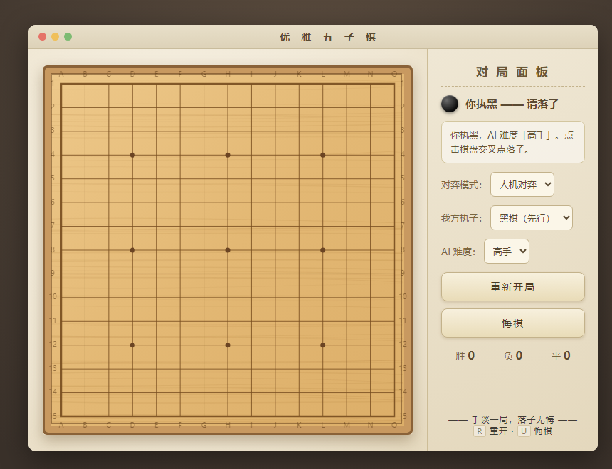

# 优雅五子棋

单文件 HTML5 Canvas 五子棋，打开就能玩：人机对弈、双人对战、悔棋、四档 AI 难度。

**在线试玩：** https://mountmyj.github.io/gomoku/

## 功能

- 15×15 棋盘，Canvas 绘制，适配高 DPI 屏幕
- 人机对弈：入门 / 进阶 / 高手 / 大师
- 双人对弈
- 悔棋、重新开局、胜负统计
- 键盘快捷键：`R` 重开，`U` 悔棋
- 单文件、零依赖，离线可用

## 本地运行

下载 `index.html`，双击用浏览器打开即可。

## AI 实现

- 五连窗口评估函数
- 迭代加深 + Alpha-Beta 剪枝（negamax）
- 候选点按进攻 / 防守启发式排序
- 搜索前先处理成五 / 挡五
- 四档搜索深度：2 / 4 / 6 / 8

## 技术栈

纯 HTML / CSS / JavaScript，无框架、无构建步骤。

## License

MIT
